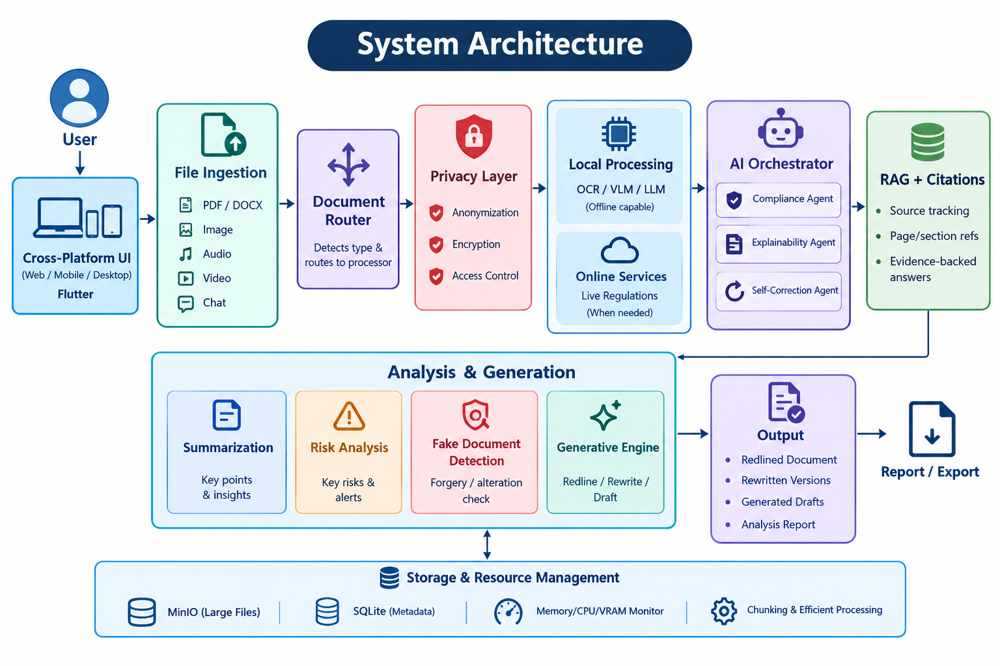

# AI Legal Document Analyzer

A privacy-first, multimodal, offline-capable legal intelligence platform built with **FastAPI** (Python 3.12) and **Flutter 3**. The system performs deep contract risk analysis, digital forensics and forgery detection, AI-powered redlining and clause rewriting, evidence-backed RAG search with citations, and PII anonymization—all running locally with zero cloud data leakage.



---

## Key Capabilities

### 1. File Ingestion & Document Router
- **Multimodal Support:** Ingests PDF, DOCX, TXT, and scanned image documents.
- **Extraction Engines:** Uses PyMuPDF (`fitz`), `python-docx`, and PaddleOCR with fallback text parsing.
- **Integrity Validation:** Computes SHA-256 cryptographic hashes for every ingested document.

### 2. Privacy & PII Anonymization Layer
- **Automated PII Redaction:** Identifies and masks sensitive personal identifiers including Names, Email addresses, Phone numbers, SSNs, Indian PAN & Aadhaar numbers, Passports, and Financial IDs.
- **Reversible Tokenization:** Generates reversible pseudonym tags (e.g. `[EMAIL_1]`, `[PERSON_1]`) allowing secure local processing with de-anonymization on demand.
- **Data-at-Rest Protection:** Simulated AES-256 GCM encryption and local SQLite audit trails.

### 3. AI Legal Risk & Compliance Engine
- **Risk Scoring (0–100):** Evaluates contracts for severe legal vulnerabilities:
  - Uncapped indemnification covenants
  - Unilateral termination for convenience
  - Absence of aggregate liability caps
  - Overly broad non-compete restrictions
  - Auto-renewal trapdoors
  - Inconvenient foreign litigation venues
- **Clause Categorization:** Classifies standard, risky, and omitted clauses.
- **Obligation Matrix:** Extracts explicit party duties, conditions, and deadlines.

### 4. Digital Forensics & Fake Document Detection
- **Authenticity Scoring:** Analyzes PDF binary streams, trailer revision trees, and metadata timelines.
- **Forgery Checks:** Detects timestamp tampering (e.g. ModDate preceding CreationDate), image editing tool signatures (Photoshop, GIMP, Canva), font layer inconsistencies, and digital signature dictionaries (PKCS#7).

### 5. Generative Redlining & Clause Rewriter
- **Balanced Clause Proposals:** Generates attorney-grade replacement provisions restoring commercial fairness.
- **Unified Diff Views:** Highlights additions (`+`) and deletions (`-`) side by side.
- **Interactive Review:** One-click Accept or Reject workflow that updates the contract in real time.

### 6. Local RAG & Evidence Citations
- **Offline RAG Indexer:** Chunks contract text by page and clause headings using semantic sliding windows.
- **Evidence-Backed Answers:** Retrieves exact contract answers citing specific clause titles, page numbers, and verbatim quotes.

### 7. Cross-Platform Flutter Interface
- Modern, dark-themed responsive UI for Windows Desktop and Web.
- **9 Core Modules:**
  1. **Dashboard Overview:** High-level metrics, active risk posture, recent documents.
  2. **Workspace:** Drag-and-drop document uploader, file repository, metadata viewer.
  3. **AI Analysis:** Risk scorecards, executive summaries, high-risk cards, and obligations table.
  4. **AI Assistant:** RAG-powered interactive legal chat with citation pills.
  5. **Redlining:** Side-by-side clause revision comparisons with diff views.
  6. **Verification:** Digital forensics checklist and structural anomaly inspector.
  7. **Reports:** Markdown and JSON legal audit report generator and archiver.
  8. **Privacy:** PII entity breakdown, original vs masked preview, encryption status.
  9. **Settings:** Offline mode switch, inference model selection, backend health probe.

---

## System Architecture

```
                   ┌──────────────────────────────────────────────┐
                   │             System Architecture              │
                   └──────────────────────────────────────────────┘
                                          │
         ┌────────────────────────────────┴────────────────────────────────┐
         ▼                                                                 ▼
[Flutter UI (Desktop/Web)]                                        [FastAPI Backend]
- Dashboard Overview                                               - Ingestion & OCR: PDF, DOCX, TXT, Images
- Ingestion Workspace                                              - Privacy Layer: PII Anonymization, AES-256
- AI Analysis & Metrics                                            - Risk Engine: Scoring 0-100, High/Med/Low
- RAG Assistant with Citations                                     - Verification: Forensics, Forgery Checks
- Side-by-Side Redlining                                           - Redlining: Balanced Clause Rewriter, Diffs
- Authenticity Verification                                        - Local RAG: BM25/TF-IDF with page citations
- Audit Reports & Exports                                          - Database: SQLite (database/legal_analyzer.db)
- Privacy Shield                                                   - Storage: documents/ & reports/
```

---

## Directory Structure

```
AI_Legal_Document_Analyzer/
├── architecture.png               # System architecture diagram
├── run_backend.bat                # Windows 1-click launcher for FastAPI backend
├── run_frontend.bat               # Windows 1-click launcher for Flutter UI
├── requirements.txt               # Python backend dependencies
├── database/                      # SQLite metadata and audit ledger
│   └── legal_analyzer.db
├── documents/                     # Ingested contracts and sample legal agreements
│   ├── sample_vendor_service_agreement.txt
│   └── sample_non_disclosure_agreement.txt
├── reports/                       # Generated Markdown and JSON legal audit reports
├── backend/                       # FastAPI application
│   ├── requirements.txt
│   └── app/
│       ├── main.py                # FastAPI entrypoint and CORS configuration
│       ├── config.py              # Environment paths and thresholds
│       ├── database.py            # SQLite database schema and connection manager
│       ├── models/
│       │   ├── __init__.py
│       │   └── schemas.py         # Pydantic data models
│       ├── services/
│       │   ├── ingestion_service.py      # PDF, DOCX, Image, Text extraction
│       │   ├── privacy_service.py        # PII regex and reversible tokenization
│       │   ├── risk_analysis_service.py  # Legal risk scoring and clause checks
│       │   ├── summarization_service.py  # Executive summary generator
│       │   ├── fake_detection_service.py # Digital forensics and tampering scan
│       │   ├── redlining_service.py      # Unified diff and clause rewriter
│       │   ├── rag_citation_service.py   # Semantic chunk indexer and RAG
│       │   ├── orchestrator_service.py   # Multi-agent compliance and validation
│       │   ├── report_service.py         # Markdown and JSON report generator
│       │   └── system_monitor_service.py # CPU, RAM, and document telemetry
│       └── routers/
│           ├── documents_router.py
│           ├── analysis_router.py
│           ├── assistant_router.py
│           ├── redlining_router.py
│           ├── verification_router.py
│           ├── privacy_router.py
│           ├── reports_router.py
│           └── system_router.py
└── frontend/                      # Flutter application
    ├── pubspec.yaml               # Dependencies (http, file_picker, cupertino_icons)
    └── lib/
        ├── main.dart              # App initialization and theme setup
        ├── theme/app_theme.dart   # Dark modern design palette
        ├── models/models.dart     # Dart domain models
        ├── services/
        │   ├── api_service.dart   # HTTP client with automatic offline fallback
        │   ├── document_service.dart
        │   └── ai_service.dart
        ├── widgets/
        │   ├── app_sidebar.dart   # 9-item modular navigation sidebar
        │   ├── top_bar.dart       # Active document selector, backend status pill
        │   └── status_bar.dart    # Telemetry and privacy monitor
        └── screens/
            ├── dashboard/dashboard_screen.dart
            ├── workspace/workspace_screen.dart
            ├── analysis/analysis_screen.dart
            ├── assistant/assistant_screen.dart
            ├── redlining/redlining_screen.dart
            ├── verification/verification_screen.dart
            ├── reports/reports_screen.dart
            ├── privacy/privacy_screen.dart
            ├── settings/settings_screen.dart
            └── login/login_screen.dart
```

---

## Quick Start Guide

### 1. Launching the Backend

Double click **`run_backend.bat`** or run from powershell:

```powershell
.\run_backend.bat
```

The FastAPI server starts on:
- API Server: `http://127.0.0.1:8000`
- Interactive OpenAPI Docs: `http://127.0.0.1:8000/docs`
- ReDoc: `http://127.0.0.1:8000/redoc`

### 2. Launching the Frontend

Double click **`run_frontend.bat`** or run from powershell:

```powershell
.\run_frontend.bat
```

Or run directly with Flutter:
```powershell
cd frontend
flutter run -d windows    # Desktop app
# or
flutter run -d chrome     # Web browser
```

---

## Pre-loaded Sample Agreements

Two realistic legal contracts are included in `documents/` for testing:
1. **`sample_vendor_service_agreement.txt`**: A high-risk commercial services agreement containing uncapped indemnity, 10-day unilateral termination, omitted liability limitation, and a 3-year non-compete covenant.
2. **`sample_non_disclosure_agreement.txt`**: A standard mutual non-disclosure agreement with balanced term limits and liability caps.

---

## API Endpoints Reference

| Method | Endpoint | Description |
| :--- | :--- | :--- |
| `POST` | `/api/documents/upload` | Ingests PDF/DOCX/TXT/Images, computes hash, parses text |
| `GET` | `/api/documents` | Lists all ingested documents |
| `GET` | `/api/documents/{id}` | Retrieves document metadata and full extracted text |
| `DELETE` | `/api/documents/{id}` | Deletes document and cleans up related analyses |
| `POST` | `/api/analysis/{id}` | Executes deep legal risk scoring, clauses, and obligations |
| `GET` | `/api/analysis/{id}` | Retrieves existing legal analysis |
| `POST` | `/api/assistant/chat` | RAG query answering with page and clause citations |
| `POST` | `/api/redlining/{id}/generate` | Proposes balanced clauses and unified diffs |
| `GET` | `/api/redlining/{id}` | Retrieves active redline proposals |
| `POST` | `/api/redlining/{redline_id}/decision` | Records user accept/reject decision |
| `POST` | `/api/verification/{id}/scan` | Digital forensic scan for alterations and metadata anomalies |
| `POST` | `/api/privacy/{id}/anonymize` | Redacts sensitive PII with reversible pseudonym tokens |
| `POST` | `/api/privacy/{id}/restore` | Restores original text using private token ledger |
| `POST` | `/api/reports/{id}/generate` | Compiles Markdown legal audit report into `reports/` |
| `GET` | `/api/reports` | Lists all generated audit reports |
| `GET` | `/api/system/status` | Real-time CPU, RAM, and document database telemetry |
| `GET` | `/health` | Health check endpoint |
